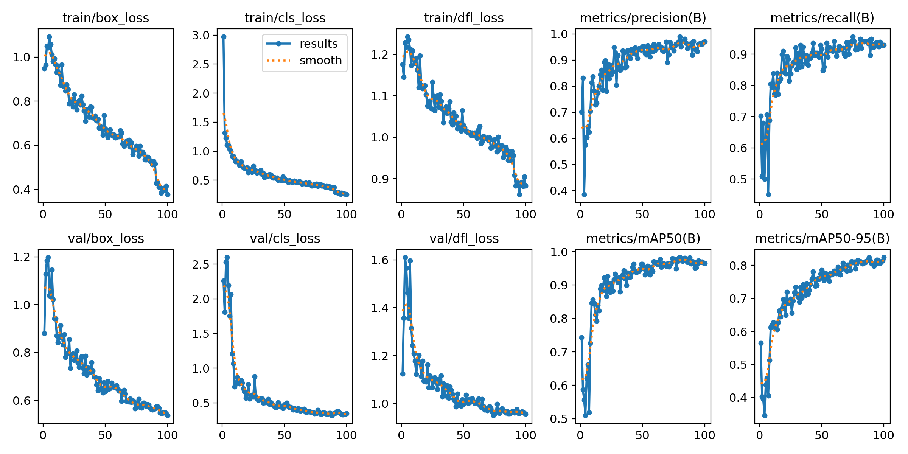

# YOLOv8 문구류 객체 감지 및 추적

형광펜(`highlighter`), 수정테이프(`correction_tape`), 지우개(`eraser`)의 공개 Roboflow 데이터셋을 병합·가공해 YOLOv8을 학습하고, ByteTrack으로 객체 ID와 이동 궤적을 표시하는 과제 프로젝트입니다. 데이터 출처와 CC BY 4.0 표기는 [data/SOURCES.md](data/SOURCES.md)를 따릅니다.

## 현재 진행 상태 — 2026-11-20

교수님이 제공하신 자료는 [과제 지침 메모](docs/ASSIGNMENT_GUIDELINES.md)에 별도로 보존했습니다. **Colab Tesla T4의 CUDA 장치 0에서 batch 16으로 100 epoch 학습과 test 평가를 완료했습니다.** 기존 데이터 687장의 분할·라벨·설정을 유지했으며, 학습 CSV의 누적 시간은 **2시간 43분 54.78초**입니다. GPU 메모리 부족이나 batch 축소 없이 한 번의 시도로 완료했고, 100회의 epoch 백업이 성공했습니다.

Test 73장·정답 객체 108개에서 **Precision 93.70%, Recall 88.77%, mAP50 93.58%, mAP50-95 76.68%**를 얻었습니다. 이 수치는 아래의 빈 라벨과 eraser 유사 장면 한계를 포함한 기존 분할의 결과입니다. **실제 원본 영상이 없어 5초 추적 영상과 궤적 CSV는 아직 제작 전입니다.**

로컬 CPU 학습은 batch 16·8의 메모리 오류 후 batch 4로 1 epoch를 완료했습니다. 2번째 epoch 44%에서 19:28 KST 사용자 요청으로 일시정지했으며 메모리 상태·체크포인트·로그를 보존했습니다. 이 중간 결과를 최종 모델 또는 test 성능으로 사용하지 않습니다. 원본 영상은 사용자가 준비할 예정입니다.

- 인계 및 다음 실행 조건: [HANDOFF.md](HANDOFF.md)
- 실제 데이터 감사 결과: [outputs/dataset_summary.json](outputs/dataset_summary.json)
- 실제 Colab 환경과 데이터 검사: [colab_environment.json](outputs/colab_environment.json), [colab_dataset_check.json](outputs/colab_dataset_check.json)
- 학습 완료·산출물 검증: [colab_training_run.json](outputs/colab_training_run.json), [artifact_verification.json](outputs/artifact_verification.json)
- 학습 모델·test 지표: [best.pt](models/best.pt), [test_metrics.json](outputs/test_metrics.json)
- 로컬 CPU 실행 상태: `outputs/training_status.json` (로컬 전용, Git 제외)
- 확인된 사실과 미완료 항목: [report/REPORT.md](report/REPORT.md)
- 공개 저장소: https://github.com/jeongjunseo/yolov8-stationery-tracking

`models/best.pt`는 6,500,778 bytes이며 Colab 기록과 SHA-256이 일치합니다. 로컬 CPU에서 모델을 불러와 세 클래스와 파일 무변경을 확인했습니다. 아래 학습·평가 명령은 완료된 실험의 재현 절차이며, 영상 제작 명령은 원본 제공 후 실행할 절차입니다.

## Colab에서 실행

[Colab에서 노트북 열기](https://colab.research.google.com/github/jeongjunseo/yolov8-stationery-tracking/blob/main/notebooks/train_colab.ipynb)

1. GPU 런타임을 연결하고 노트북의 셀을 순서대로 실행합니다. `nvidia-smi`와 PyTorch CUDA 검사를 통과해야 학습을 시작합니다.
2. Google Drive 연결을 승인합니다. 기본 데이터 위치는 `MyDrive/yolov8-stationery-tracking/`이며, 전체 ZIP 또는 `stationery_dataset.parts.json`에 나열된 분할 파일을 읽습니다. 분할 파일은 `/content/stationery_dataset.zip`으로 재조립하고 각 조각·전체 ZIP·이미지·라벨의 SHA-256을 검사합니다.
3. 기존 `scripts/train.py`를 YOLOv8n, batch 16, epochs 100, imgsz 640, seed 42로 실행합니다. 실제 CUDA 메모리 부족이 발생할 때만 batch를 8 또는 4로 낮춥니다. 콜백으로 체크포인트를 백업하고 라이브러리의 내부 batch 자동 변경을 차단하여 이 조건을 지킵니다. 모델·증강·최적화·시드 설정은 그대로 유지합니다.
4. 학습 완료 후 test 평가와 고정 임계값 실패 분석을 실행합니다. 원본 영상이 없으면 영상 단계는 보류하고 모델·성능·그래프를 먼저 저장합니다.
5. 체크포인트와 결과 ZIP은 Drive의 `yolov8-stationery-tracking/colab_runs/<run-id>/`에 저장합니다. 측정된 결과를 검토한 뒤 README와 보고서를 완성하고 GitHub에 반영합니다.

Colab은 로컬 `.venv`나 Windows junction을 사용하지 않습니다. 노트북은 실제 GPU 장치와 완료 epoch 수를 확인하며, CPU 중간 체크포인트를 완료된 Colab 학습 결과로 대체하지 않습니다.

## 1. 데이터 기준

- 프로젝트 자체 검사 기준: 클래스별 100장 이상, 총 300장 이상
- 권장 분할: train 70%, valid 20%, test 10%
- 같은 장면에서 연속 촬영한 사진은 반드시 같은 split에 배치
- 클래스 번호는 변경하지 않음

| ID | 클래스 | 한글명 |
|---:|---|---|
| 0 | `highlighter` | 형광펜 |
| 1 | `correction_tape` | 수정테이프 |
| 2 | `eraser` | 지우개 |

Roboflow에서 **YOLOv8** 형식으로 내려받은 뒤 아래 구조로 배치합니다.

```text
data/
├─ stationery.yaml
├─ train/
│  ├─ images/
│  └─ labels/
├─ valid/
│  ├─ images/
│  └─ labels/
└─ test/
   ├─ images/
   └─ labels/
```

복원한 기존 데이터의 실제 구성은 다음과 같습니다. 재분할하거나 기존 라벨을 변경하지 않았습니다.

| 구분 | train | valid | test | 합계 |
|---|---:|---:|---:|---:|
| 이미지 / 라벨 파일 | 498 / 498 | 116 / 116 | 73 / 73 | 687 / 687 |
| 이미지 비율 | 72.49% | 16.89% | 10.63% | 100% |
| 객체 박스 | 614 | 146 | 108 | 868 |
| 빈 라벨 파일 | 15 | 4 | 2 | 21 |

| 클래스 | 포함 이미지 | 객체 박스 |
|---|---:|---:|
| highlighter | 219 | 224 |
| correction_tape | 129 | 259 |
| eraser | 318 | 385 |

이미지 687장 디코딩과 기존 검사 스크립트의 좌표·완전 중복 검사는 통과했습니다. 다만 [빈 라벨 이미지 연락시트](outputs/dataset_audit/empty_labels_contact_sheet.jpg)의 02번에는 형광펜이 보이는데 라벨은 비어 있어 추가 검토가 필요합니다. 검사 통과가 라벨 내용의 완전성을 보장하지는 않습니다.

추가 [유사 장면 감사](outputs/dataset_audit/near_duplicate_audit.json)에서는 split이 다른 이미지 조합 102,590쌍을 비교했습니다. 바이트가 완전히 같은 쌍은 0개였지만, 이미지 해시와 색상 차이 기준을 만족한 유사 후보 494쌍이 모두 eraser에서 나왔습니다(train–valid 239쌍, train–test 210쌍, valid–test 45쌍). 후보에 포함된 고유 이미지는 train 136장·valid 54장·test 30장이며, test 29장은 train 이미지와 후보 관계에 있었습니다.

가장 유사한 후보 중 이미지가 서로 겹치지 않는 12쌍을 [연락시트 1](outputs/dataset_audit/near_duplicate_candidates_01.jpg)·[연락시트 2](outputs/dataset_audit/near_duplicate_candidates_02.jpg)에서 검토한 결과, 거의 같은 배경·물체 배치·시점이 split을 넘나드는 사례를 확인했습니다. 다만 [임계값 근처 6쌍](outputs/dataset_audit/near_duplicate_threshold/near_duplicate_candidates_01.jpg)에는 회전·시점 차이가 분명한 사례도 있어 **494쌍 전체를 확정 중복으로 해석하지 않습니다.** 상세 해시는 [이미지별 기록](outputs/dataset_audit/near_duplicate_image_hashes.json)에 있습니다. 이 결과는 특히 eraser의 validation·test 성능을 새로운 장면에 대한 일반화 성능으로 해석할 때의 한계입니다. 영향의 크기는 아직 측정하지 않았습니다.

이번 학습은 기존 분할·라벨·설정을 유지한 기준 실험으로 완료했으며, 이미지·라벨 1,374개 파일의 SHA-256이 원본 ZIP 매니페스트와 일치함을 확인했습니다. 개별 시각 판정과 원본 보존 검사는 [시각 검토 기록](outputs/dataset_audit/near_duplicate_visual_review.json)에 남겼습니다. 후속 실험에서는 촬영 세션·장면별로 이미지를 묶어 같은 그룹을 하나의 split에만 배치하고, 누락 라벨을 검토한 뒤 동일 학습 설정으로 결과를 비교하는 것이 필요합니다.

## 2. 설치

로컬 Windows 환경을 새로 구성할 때는 PowerShell에서 프로젝트 루트로 이동한 뒤 실행합니다. 현재 Colab 실행은 위 노트북의 설치 절차를 사용합니다.

```powershell
python -m venv .venv
.venv\Scripts\Activate.ps1
python -m pip install --upgrade pip
pip install -r requirements.txt
```

GPU 학습 PC에서는 `nvidia-smi`로 NVIDIA GPU와 드라이버를 확인한 후 [PyTorch 공식 설치 안내](https://docs.pytorch.org/get-started/locally/)에서 해당 환경에 맞는 CUDA 지원 빌드를 설치합니다. 이전 PC의 `.venv`는 복사하지 않습니다. `pip install -r requirements.txt`만으로 CUDA 사용 가능 상태가 보장되지는 않습니다.

```powershell
python -c "import torch; print(torch.cuda.is_available(), torch.cuda.get_device_name(0) if torch.cuda.is_available() else 'CPU')"
```

GPU 실행은 `torch.cuda.is_available()`이 `True`여야 합니다. 실제 Colab에서는 Tesla T4, Python 3.13.16, PyTorch 2.14.1+cu130, CUDA 13.0, Ultralytics 8.4.215와 CUDA 인식 `True`를 확인했습니다. Colab의 `pip check`는 기존 IPython의 `jedi` 누락을 경고했으며, 이후 핵심 패키지 import와 CUDA 검사는 통과했습니다. 로컬 CPU 환경의 설치·검사 이력은 [보고서](report/REPORT.md)에 별도로 기록합니다.

## 3. 데이터 검사

라벨 범위, 이미지-라벨 대응, split별 수량, 클래스별 포함 이미지 수, split 사이의 완전 중복 이미지를 검사합니다.

```powershell
python scripts/check_dataset.py
```

위 수량 기준은 기존 프로젝트 검사 설정이며, 제공된 교수님 자료에 명시된 최소 수량으로 단정하지 않습니다. 현재 데이터는 기본 검사 조건을 유지해 확인했습니다.

## 4. 학습

YOLOv8 nano 사전 학습 가중치로 100 epoch 전이학습을 수행합니다. 현재 Colab GPU 실행의 기본 명령은 다음과 같습니다.

```powershell
python scripts/train.py --device 0 --batch 16 --epochs 100
```

설정은 YOLOv8n, imgsz 640, workers 인자 4, seed 42, deterministic=True, optimizer=auto이며 [실제 args.yaml](report/assets/train/args.yaml)에 저장했습니다. [학습 완료 기록](outputs/colab_training_run.json)과 [100행 CSV](report/assets/train/results.csv)로 실제 batch 16과 100 epoch 완료를 검증했습니다. 실제 CUDA 메모리 부족이 발생할 때만 batch를 16에서 8, 4 순서로 낮추는 조건이지만 이번 GPU 실행에는 필요하지 않았습니다. 이전 로컬 CPU 시도는 batch 16·8의 메모리 오류 후 batch 4로 1 epoch를 완료했고, 사용자 요청으로 일시정지되어 있습니다.

학습 결과는 `runs/train/` 아래에 저장되고 완료 후 최적 가중치는 자동으로 `models/best.pt`에 복사됩니다. Colab은 해당 런타임의 로컬 디스크를 사용하고 Drive에 체크포인트를 백업합니다. 이전 Windows 실행의 `runs/`는 D:에 연결되어 있으며 그대로 보존합니다. 보고서에는 다음 자료를 사용합니다.

- [results.csv](report/assets/train/results.csv): epoch별 loss와 validation 성능
- [results.png](report/assets/train/results.png): 학습 곡선
- [test 혼동 행렬](report/assets/test/confusion_matrix.png), [test PR 곡선](report/assets/test/BoxPR_curve.png)
- [models/best.pt](models/best.pt): 완료된 실행에서 선택된 학습 모델



## 5. test 데이터 평가

```powershell
python scripts/evaluate.py --device 0
```

전체 Precision, Recall, mAP50, mAP75, mAP50-95와 클래스별 Precision, Recall, mAP50, mAP50-95, 정답 객체 수가 `outputs/test_metrics.json`에 저장됩니다. 평가되지 않은 클래스의 수치는 `null`로 기록합니다. 평가 그래프는 `runs/val/`에 저장됩니다.

완료된 GPU 평가의 실측값은 다음과 같습니다. 모든 성능 수치는 %이며, 전체 행은 클래스 평균입니다.

| 클래스 | 정답 객체 | Precision | Recall | mAP50 | mAP50-95 |
|---|---:|---:|---:|---:|---:|
| 전체 | 108 | 93.70 | 88.77 | 93.58 | 76.68 |
| highlighter | 23 | 89.07 | 91.30 | 93.68 | 87.09 |
| correction_tape | 44 | 93.06 | 75.00 | 87.56 | 48.35 |
| eraser | 41 | 98.98 | 100.00 | 99.50 | 94.60 |

전체 mAP75는 80.10%입니다. 수정테이프는 여러 객체를 묶거나 물체 일부만 잡는 위치 오류가 관찰됐고, 엄격한 IoU 기준에서 성능 하락이 컸습니다. 지우개의 높은 성능은 위 유사 장면 문제 때문에 새로운 장면에 대한 일반화 성능으로 그대로 해석할 수 없습니다. [보고서](report/REPORT.md)에 실제 실패 그림과 클래스별 분석을 정리했습니다.

[고정 임계값 진단](outputs/failure_analysis.json)은 confidence 0.25, NMS IoU 0.5, 정답 매칭 IoU 0.5에서 TP 95 / FP 10 / FN 13을 기록했습니다. 이 진단의 전체 precision·recall은 객체 수를 합산한 값이므로 위 공식 평가의 클래스 평균·신뢰도 곡선 기반 값과 구분합니다.

## 6. 5초 추적 영상 제작

세 객체가 모두 보이고 천천히 이동하는 5초 이상의 원본 영상을 `inputs/source.mp4`에 둡니다.

```powershell
python scripts/track_video.py --source inputs/source.mp4 --model models/best.pt --device 0 --output outputs/final_5s_render.mp4
ffmpeg -n -i outputs/final_5s_render.mp4 -map 0:v:0 -an -c:v libx264 -preset medium -crf 18 -pix_fmt yuv420p -fps_mode passthrough -movflags +faststart outputs/final_5s.mp4
```

위 제출 절차는 FFmpeg의 `libx264` 인코더를 사용할 수 있는 환경에서 실행합니다. OpenCV가 만든 `mp4v` 렌더링 파일은 보존하고, [GitHub에서 권장하는 H.264](https://docs.github.com/en/get-started/writing-on-github/working-with-advanced-formatting/attaching-files) 형식으로 최종 파일을 따로 만듭니다. `-n`은 기존 파일의 덮어쓰기를 막습니다. 변환 후에도 전체 프레임 수·타임스탬프·5초 재생 길이와 CSV 일치를 확인합니다. 실제 원본 영상이 아직 없어 이 영상 제작 절차는 실행 전입니다.

생성 결과:

- `outputs/final_5s.mp4`: 클래스명, 신뢰도, 추적 ID, 이동 궤적이 표시된 5초 영상
- `outputs/trajectory.csv`: 프레임별 객체 중심 좌표와 추적 ID

신뢰도 임계값은 필요할 때만 조정합니다.

```powershell
python scripts/track_video.py --conf 0.35 --trail-length 90
```

ByteTrack은 프레임 사이의 객체 ID를 연결하는 추적기이며 별도의 재식별(Re-ID) 모델을 사용하지 않습니다.

출력 프레임 수를 `round(원본 FPS × 5)`로 정하고, 출력 FPS를 `프레임 수 / 5`로 정규화합니다. 예를 들어 29.97 FPS 입력에서는 150프레임을 30 FPS로 저장해 출력 시간축을 5초로 맞춥니다. 이 경우 재생 속도가 약 0.1% 달라지며 CSV의 `time_sec`는 출력 영상 기준입니다. 실제 제출 영상은 생성 후 컨테이너 재생 시간과 프레임 수까지 검증해야 합니다.

기존 영상이나 CSV가 있으면 덮어쓰지 않고 중단합니다. 재실행 시 `--output`과 `--trajectory`로 새로운 경로를 지정합니다.

## 7. 보고서와 GitHub 제출

[report/REPORT.md](report/REPORT.md)에 완료된 Colab 학습·test 성능·실패 사례와 이전 CPU 시도를 구분해 기록했습니다. 원본 영상에 대한 실제 추적 결과와 검증이 남아 있으므로 전체 과제는 아직 완료되지 않았습니다. 최종 제출 경로는 다음과 같습니다.

```text
models/best.pt
outputs/final_5s.mp4
outputs/test_metrics.json
outputs/trajectory.csv
report/REPORT.md
README.md
scripts/
data/stationery.yaml
```

[GitHub 공식 제한](https://docs.github.com/en/repositories/working-with-files/managing-large-files/about-large-files-on-github)에 따라 파일 하나가 100 MiB를 넘으면 일반 push가 거부되므로, 그런 경우에만 Git LFS를 사용합니다. 원본 데이터 이미지와 라벨은 기본적으로 `.gitignore`에 포함되어 있습니다.

`runs/`는 Git에서 제외되므로 실제 생성된 CSV·설정·학습 곡선은 [report/assets/train/](report/assets/train/), test 그래프는 [report/assets/test/](report/assets/test/), 실패 그림은 [report/assets/failures/](report/assets/failures/)로 복사했습니다. 42개 그림의 무결성과 모델 로딩을 확인했으며, 현재 결과 파일은 모두 100 MiB 미만입니다. 가장 큰 결과 파일은 6,500,778 bytes의 모델입니다. [검증 기록](outputs/artifact_verification.json)은 영상·CSV가 미완료임도 명시합니다.

코드 회귀 검증은 `python -m unittest discover -s tests -v`로 실행합니다. 이 테스트의 영상은 임시 합성 데이터와 모의 검출 결과를 사용하며 실제 학습·검출 성능이나 ByteTrack의 ID 유지 성능을 입증하지 않습니다.

