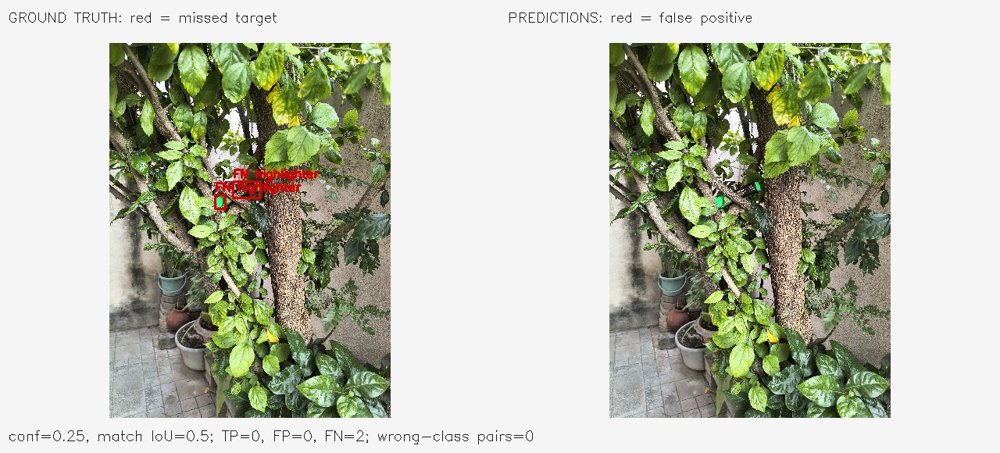
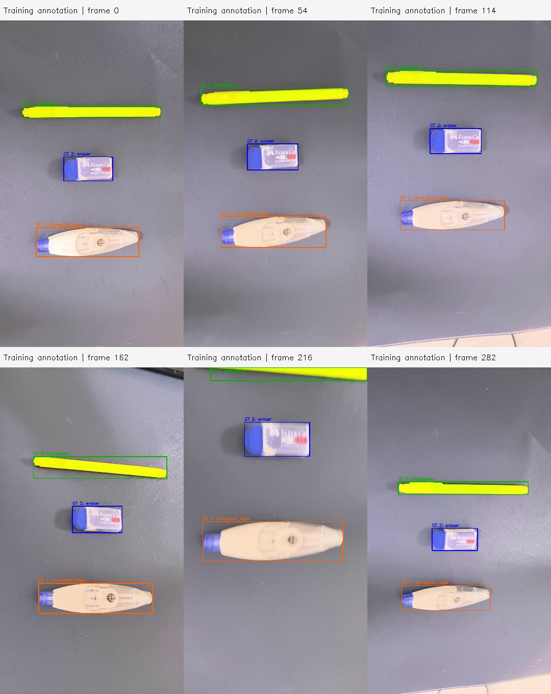
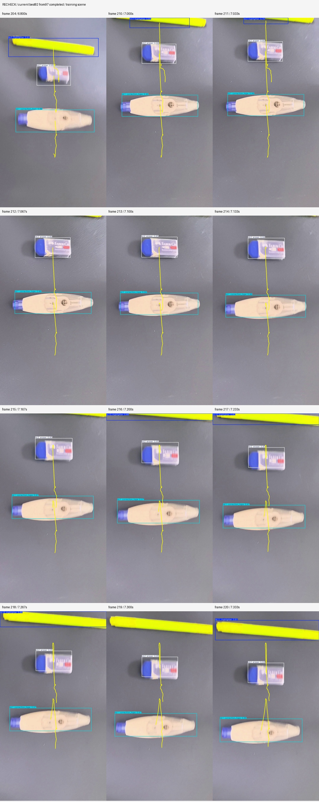
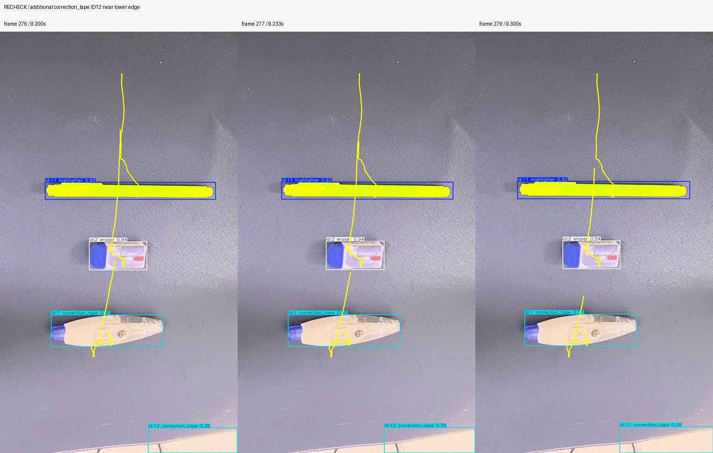

# YOLOv8 문구류 객체 감지·추적 결과보고서

GitHub: https://github.com/jeongjunseo/yolov8-stationery-tracking

## 1. 실험 개요

YOLOv8n으로 형광펜(highlighter), 수정테이프(correction_tape), 지우개(eraser)를 학습하고, test 데이터에서 성능을 평가했다. 영상에는 ByteTrack으로 연결한 추적 ID와 객체 중심점의 궤적을 표시했다.

기준 실험은 Colab Tesla T4에서 100 epoch 학습과 test 평가를 완료했다. Test 73장·108개 객체에서 precision 93.70%, recall 88.77%, mAP50 93.58%, mAP50-95 76.68%를 얻었다. 모델과 정확히 5초인 결과 영상을 공개했다.

실제 영상에서 남은 미검출·오분류를 줄이기 위해 영상 프레임 48장을 추가한 보완 실험도 진행했다. 현재 97/100 epoch이며, validation 기준 최고 모델인 best82로 앞 5초의 세 물체 표시를 개선했다. 보완 모델의 100 epoch 완료와 원래 test 평가·가중치 공개는 대기 중이다. 아래 test 성능표는 기준 모델의 결과다.

## 2. 데이터 구성과 전처리

Roboflow Universe의 공개 데이터셋 세 종류를 사용했다. 원본은 CC BY 4.0으로 명시되어 있으며, 상세 출처는 [data/SOURCES.md](../data/SOURCES.md)에 정리했다.

| 클래스 ID / 이름 | 출처 | 원본 이미지 | 전처리 |
|---|---|---:|---|
| 0 / highlighter | [Highlighter](https://universe.roboflow.com/visioncoprocessor/highlighter-g3fru) | 240 | 폴리곤을 검출 박스로 변환 |
| 1 / correction_tape | [Assignment_Correction tape](https://universe.roboflow.com/kyonggiuniv/assignment_correction-tape) | 129 | 경계를 조금 벗어난 박스 6개 보정 |
| 2 / eraser | [eraser](https://universe.roboflow.com/reder/eraser-xnm4s) | 318 | 세 색상 클래스를 eraser로 통합 |

기존 train·valid·test 분할을 유지했다. 전체 687장 중 빈 라벨 이미지가 21장 포함된다.

| 구분 | train | valid | test | 합계 |
|---|---:|---:|---:|---:|
| 이미지 / 라벨 파일 | 498 / 498 | 116 / 116 | 73 / 73 | 687 / 687 |
| 객체 박스 | 614 | 146 | 108 | 868 |
| 빈 라벨 파일 | 15 | 4 | 2 | 21 |

다음 표는 클래스별 **포함 이미지 수 / 객체 박스 수**이다.

| 클래스 | train | valid | test | 전체 |
|---|---:|---:|---:|---:|
| highlighter | 177 / 180 | 21 / 21 | 21 / 23 | 219 / 224 |
| correction_tape | 89 / 163 | 26 / 52 | 14 / 44 | 129 / 259 |
| eraser | 217 / 271 | 65 / 73 | 36 / 41 | 318 / 385 |

데이터 검사에서 이미지·라벨 대응, 좌표 범위, 클래스 구성에 오류가 없었고, 687장 모두 디코딩됐다. Colab에서도 train 498장·valid 116장·test 73장을 확인했다. 집계와 검사는 [dataset_summary.json](../outputs/dataset_summary.json), [colab_dataset_check.json](../outputs/colab_dataset_check.json)에 저장했다.

### 데이터 품질의 한계

[빈 라벨 이미지 모음](../outputs/dataset_audit/empty_labels_contact_sheet.jpg)의 02번 이미지에는 왼쪽 가장자리의 녹색 뚜껑 형광펜이 보이지만 라벨이 없다. 라벨 파일의 형식 검사를 통과해도 정답 누락이 남을 수 있음을 보여준다. 기준 실험은 해당 라벨을 포함한 기존 데이터를 그대로 사용했다.

Split 간 102,590쌍을 비교했을 때 바이트가 같은 완전 중복은 없었다. pHash·dHash·RGB 차이로 선별한 유사 후보는 494쌍(train–valid 239, train–test 210, valid–test 45)이었으며 모두 eraser였다. 이는 자동 선별 후보 수이며 확정 중복 수가 아니다.

유사도가 높은 12쌍에서는 배경·물체 배치·시점이 거의 같은 장면이 서로 다른 split에 분포했다. 임계값 근처 6쌍에는 물체 회전이나 시점 변화가 뚜렷한 사례도 있었다. 따라서 eraser의 평가 수치가 새로운 장면에서의 성능보다 낙관적일 가능성이 있으며, 영향의 크기는 별도로 측정하지 않았다. 후속 데이터 구성에는 촬영 장면 단위 분할과 누락 라벨 보완이 필요하다.

근거: [유사 후보 집계](../outputs/dataset_audit/near_duplicate_audit.json) · [표본 이미지 1](../outputs/dataset_audit/near_duplicate_candidates_01.jpg) · [표본 이미지 2](../outputs/dataset_audit/near_duplicate_candidates_02.jpg) · [표본 검토 기록](../outputs/dataset_audit/near_duplicate_visual_review.json)

## 3. 학습 환경과 과정

로컬 PC는 AMD Ryzen 5 5500GT와 Radeon 내장 그래픽을 사용해 CUDA를 사용할 수 없었다. CPU 학습은 batch 16·8에서 메모리 부족이 발생했고, batch 4로 1 epoch를 완료한 뒤 중단했다. 최종 기준 실험은 별도로 구성한 Colab GPU 환경에서 진행했다.

| 항목 | 기준 실험 설정 |
|---|---|
| 환경 / GPU | Google Colab / Tesla T4, CUDA 장치 0 |
| Python | 3.13.16 |
| PyTorch / torchvision | 2.14.1+cu130 / 0.29.1+cu130 |
| CUDA / Ultralytics | 13.0 / 8.4.215 |
| OpenCV / PyYAML | 4.14.0.94 / 6.0.3 |
| 초기 모델 | COCO 사전 학습 YOLOv8n |
| epochs / batch / imgsz | 100 / 16 / 640 |
| workers / seed / deterministic | 4 / 42 / True |
| optimizer / 초기 학습률 | auto에서 AdamW 선택 / 0.001429 |
| AMP / cache | True / False |
| 학습 시간 | 9,834.78초, 약 2시간 44분 |

실행 명령은 `python scripts/train.py --device 0 --batch 16 --epochs 100`이다. GPU에서는 batch 축소 없이 한 번의 시도로 100 epoch를 완료했고, epoch별 Drive 백업 100회가 성공했다. 학습 시간에는 설치·데이터 전송·후속 평가 시간이 포함되지 않는다.

환경과 설정은 [colab_environment.json](../outputs/colab_environment.json), [args.yaml](assets/train/args.yaml), [학습 완료 기록](../outputs/colab_training_run.json)에 저장했다.

[results.csv](assets/train/results.csv)의 학습 box loss는 0.94820에서 0.37691로, validation box loss는 0.88072에서 0.53754로 감소했다. Validation mAP50-95는 첫 epoch의 0.56468에서 마지막 epoch의 0.82376으로 상승했다. CSV 최고값은 epoch 88의 0.82416이며, test 성능이나 저장 모델의 선택 epoch와 동일한 의미는 아니다.

기준 모델 [models/best.pt](../models/best.pt)는 6,500,778 bytes, 파라미터 3,138,489개다. Colab 기록과 모델 해시가 일치했고, CPU 로딩에서 세 클래스 구성을 확인했다. 모델·CSV·그래프 검증 결과는 [artifact_verification.json](../outputs/artifact_verification.json)에 저장했다.

## 4. Test 성능과 실패 분석

학습 후 `python scripts/evaluate.py --device 0`으로 기준 모델을 평가했다. Test는 73장·108개 정답 객체이며, [test_metrics.json](../outputs/test_metrics.json)에 전체·클래스별 결과를 저장했다. 아래 수치는 % 단위다.

| 클래스 | 정답 객체 | Precision | Recall | mAP50 | mAP50-95 |
|---|---:|---:|---:|---:|---:|
| 전체 (클래스 평균) | 108 | 93.70 | 88.77 | 93.58 | 76.68 |
| highlighter | 23 | 89.07 | 91.30 | 93.68 | 87.09 |
| correction_tape | 44 | 93.06 | 75.00 | 87.56 | 48.35 |
| eraser | 41 | 98.98 | 100.00 | 99.50 | 94.60 |

전체 mAP75는 80.10%다. AP는 신뢰도에 따른 precision–recall 곡선으로 계산하며, mAP50-95는 IoU 0.50부터 0.95까지 10개 기준의 평균이다. 표의 precision·recall은 평활화한 클래스 평균 F1이 최대가 되는 공통 신뢰도에서 계산한 값이다.

혼동 행렬은 가로축이 정답, 세로축이 예측이다. Confidence > 0.001의 예측을 집계하므로 표의 precision·recall과 단순 비율이 일치하지 않는다. [F1 곡선](assets/test/BoxF1_curve.png)과 [정규화 혼동 행렬](assets/test/confusion_matrix_normalized.png)도 함께 저장했다.

수정테이프는 recall 75.00%, mAP50-95 48.35%로 가장 낮았다. mAP50 대비 39.21%p 하락했으며, 이웃 객체를 함께 묶거나 물체 일부만 포함한 박스가 관찰됐다. Train 포함 이미지가 89장으로 상대적으로 적고 test 14장에 44개 객체가 밀집해 있으나, 데이터량만을 성능 차이의 원인으로 확정할 수는 없다.

형광펜은 배경의 검은 띠를 잘못 검출하거나 복잡한 배경의 작은 물체를 놓쳤다. 지우개는 mAP50-95 94.60%로 가장 높았지만, split 간 유사 장면 때문에 새로운 배경에서의 성능을 별도로 확인할 필요가 있다.

### 고정 임계값 오류 진단

Confidence 0.25, NMS IoU 0.5, imgsz 640, rect=False에서 같은 클래스 박스를 IoU ≥ 0.5로 일대일 대응시켰다. Test 73장 중 10장에 FP 또는 FN이 있었다. 공식 평가의 NMS IoU는 0.7이므로 아래 진단과 조건이 다르다.

| 클래스 | TP | FP | FN |
|---|---:|---:|---:|
| highlighter | 21 | 3 | 2 |
| correction_tape | 33 | 7 | 11 |
| eraser | 41 | 0 | 0 |
| 합계 | 95 | 10 | 13 |

객체 수를 합산한 micro precision은 90.48%, recall은 87.96%다. 이는 고정 임계값의 진단 결과이며 공식 AP나 위 성능표를 대체하지 않는다. 상세 결과는 [failure_analysis.json](../outputs/failure_analysis.json)에 기록했다.

| 사례 | 관찰한 오류 | TP / FP / FN |
|---|---|---:|
| [01](assets/failures/failure_01.jpg) | 검은 띠 두 곳을 형광펜으로 검출 | 3 / 2 / 0 |
| [02](assets/failures/failure_02.jpg) | 손·텍스트·여러 제품을 큰 박스로 묶음 | 1 / 1 / 3 |
| [03](assets/failures/failure_03.jpg) | 인접 수정테이프를 함께 검출하고 일부 누락 | 3 / 1 / 3 |
| [04](assets/failures/failure_04.jpg) | 수정테이프 하나를 두 부분으로 분리 검출 | 0 / 2 / 1 |
| [05](assets/failures/failure_05.jpg) | 밀집 배열의 통합 박스와 좌하단 누락 | 9 / 2 / 1 |
| [06](assets/failures/failure_06.jpg) | 포장 제품의 일부만 검출해 IoU 기준 미달 | 1 / 1 / 1 |
| [07](assets/failures/failure_07.jpg) | 나뭇가지·잎 주변 작은 형광펜 두 개 누락 | 0 / 0 / 2 |
| [08](assets/failures/failure_08.jpg) | 손에 일부 가려진 오른쪽 제품 누락 | 3 / 0 / 1 |
| [09](assets/failures/failure_09.jpg) | 왼쪽 아래 경계에서 잘린 제품 누락 | 4 / 0 / 1 |

그림 07의 원본은 6,144 × 8,192이며 긴 변을 640으로 축소하면 정답 박스는 약 18 × 24, 47 × 28 픽셀이 된다. 작은 입력상 크기와 복잡한 배경이 함께 관찰되지만 각 요인의 영향은 분리 측정하지 않았다.

## 5. 기준 모델의 5초 추적 영상

원본 1000030242.mp4는 HEVC 10-bit, BT.2020/PQ HDR 영상이며 287프레임, 약 9.57초다. 회전 메타데이터를 적용한 표시 크기는 1080 × 1920이다. FFmpeg의 zscale·Mobius 톤매핑으로 SDR BT.709 입력을 별도 생성했다.

입력 크기·방향·NMS를 비교한 뒤 아래 설정을 사용했다. SDR 변환만으로 검출이 개선되지는 않았다. 탐색 기록은 [tracking_experiments.json](../outputs/tracking_experiments.json), 전처리·추론 명령은 [실행 안내](../docs/RUNNING.md)에 정리했다.

| 항목 | 설정 |
|---|---|
| 모델 / 실행 장치 | 기준 models/best.pt / CPU |
| imgsz / 추론 회전 | 1280 / 시계방향 90도 |
| confidence / NMS IoU | 0.25 / 0.5 |
| NMS | class-agnostic |
| 추적기 | ByteTrack, persist=True, 별도 Re-ID 모델 없음 |
| 궤적 | ID별 최근 중심 좌표 60개 |

예측 좌표를 원래 세로 영상으로 복원해 클래스명·ID·궤적을 그렸다. 모델의 박스·클래스·ID를 실제 물체에 맞춰 수정하지 않았다.

[기준 5초 영상](../outputs/final_5s.mp4) · [궤적 CSV](../outputs/trajectory.csv)

| 실제 물체 | 추적 결과 |
|---|---|
| 지우개 | ID 1 유지, eraser 82행·highlighter 68행, 클래스 16회 변경 |
| 수정테이프 | ID 2와 correction_tape를 150프레임 모두 유지 |
| 노란 형광펜 | 미검출, 추적 궤적 없음 |

CSV는 300행·2개 ID다. 형광펜 클래스가 기록된 68행은 실제 형광펜의 검출이 아니라 지우개 오분류다. 따라서 ID가 이어져도 세 물체의 올바른 분류·추적이 성공한 것은 아니다.

출력은 H.264/yuv420p, 1080 × 1920, 30 FPS, 150프레임으로 정확히 5초이며 음성은 없다. [영상 검증 기록](../outputs/tracking_verification.json)의 파일·시간·좌표 검사 20개를 통과했다. 이 검사는 분류 정확도나 MOTA·IDF1 평가와 구분된다.

궤적은 화면의 중심 좌표 변화다. 영상에서 카메라가 움직이므로 실제 공간의 물체 이동 거리로 해석할 수 없다. 카메라 이동 보정과 실제 길이 단위 환산은 수행하지 않았다.

## 6. 영상 프레임을 추가한 보완 실험

기준 영상의 미검출·오분류를 보완하기 위해 SDR 영상에서 0.2초 간격으로 48프레임(0, 6, …, 282)을 추출했다. 색상과 연결 영역으로 박스를 제안한 뒤 48프레임을 검토하고 경계를 조정했다. 216번 프레임은 수정테이프의 파란 뚜껑을 포함하도록 수정했다. 기존 검출 모델의 예측을 정답으로 복사하지 않았다.

추가 데이터는 48장·144개 박스이며 클래스별 48개다. 모든 프레임은 train에만 추가해 train 546장, valid 116장, test 73장으로 구성했다. 정규화 좌표의 반올림으로 생긴 미세한 경계 초과는 v2에서 수정했다. [정답 좌표와 주석 기록](../outputs/video_finetune_annotations.json), [추가 데이터 검증 기록](../outputs/video_finetune_dataset.json)에 방법과 원본 프레임 번호를 저장했다.

기준 best.pt에서 시작해 T4·batch 16·imgsz 640·seed 42·목표 100 epoch로 학습했다. Colab 연결 중단 후 GPU 사용 한도로 재개하지 못해 현재 97 epoch, 누적 9,447.17초 상태다. 97회 백업과 optimizer·EMA·scaler가 포함된 체크포인트를 보존했다. 최초 중단 원인은 확정하지 않았다.

현재 best는 epoch 82의 validation mAP50-95 0.83085로 선택됐다. [복구 노트북](../notebooks/resume_video_finetune_colab.ipynb)은 남은 98–100 epoch를 이어 학습하도록 구성되어 있지만 실행 결과는 아직 없다. 상태는 [video_finetune_setup.json](../outputs/video_finetune_setup.json)에 기록했다.

### 현재 보완 모델의 영상 결과

Best82로 전체 287프레임을 CPU에서 추론했다. 설정은 imgsz 640, 회전 0, confidence 0.25, NMS IoU 0.5, 클래스별 NMS, ByteTrack, 최근 중심 좌표 60개다.

[보완 5초 영상](../outputs/video_finetune/recheck_5s.mp4) · [5초 궤적 CSV](../outputs/video_finetune/recheck_trajectory.csv) · [전체 약 9.57초 영상](../outputs/video_finetune/recheck_full.mp4) · [전체 궤적 CSV](../outputs/video_finetune/recheck_full_trajectory.csv)

처음 5초는 30 FPS·150프레임이며 정확히 5초다. 수정테이프 ID 1, 지우개 ID 2, 형광펜 ID 3이 각각 150프레임에 기록돼 CSV는 450행이다. 이 구간에서는 기준 영상의 형광펜 미검출·지우개 오분류가 재현되지 않았다. 전체 영상은 859행·6개 ID로, 후반에는 다음 오류가 남았다.

형광펜은 212–215프레임에서 대부분 잘리거나 화면 밖으로 나갔고, 다시 보이는 219프레임에도 추적 출력이 없었다. ID는 3→10→11로 변경됐다. 다섯 프레임 모두를 정답 기준 FN으로 세지는 않았으며, 추적 전 원시 검출을 따로 기록하지 않아 219프레임의 원인을 검출기와 추적기 중 하나로 확정할 수 없다.

276·277·279프레임에서는 아래쪽 베이지색 바닥·매트 경계를 수정테이프 ID 12로 오탐했다. 실제 수정테이프 ID 1과 지우개 ID 2는 전체 287프레임에 유지됐다.

정답이 있는 48개 학습 프레임에서 추적 후 반환된 박스를 같은 클래스·IoU ≥ 0.5 조건으로 일대일 대응시켰다.

| 클래스 | TP / FP / FN | 최소 / 평균 IoU |
|---|---:|---:|
| highlighter | 48 / 0 / 0 | 0.632 / 0.874 |
| correction_tape | 48 / 1 / 0 | 0.790 / 0.958 |
| eraser | 48 / 0 / 0 | 0.754 / 0.944 |

표본 전체 precision은 99.31%, recall은 100%다. FP 1은 라벨이 있는 276프레임의 배경 오탐이다. 이는 **같은 학습 영상의 고정 임계값 재검사**로, AP·독립 test 성능·MOTA·IDF1이 아니다. 정답이 없는 나머지 239프레임이나 새로운 촬영 장면에 같은 수치를 적용할 수 없다.

근거: [영상 재검사 기록](../outputs/video_finetune/video_recheck.json) · [실제 추적 박스](../outputs/video_finetune/recheck_inference.json) · [48프레임 대조 기록](../outputs/video_finetune/recheck_labeled_frames.json)

## 7. 실험 과정에서 얻은 경험

- CPU 학습에서 메모리 부족을 겪어 Colab GPU로 옮겼다. CUDA 지원 패키지 설치만으로 GPU를 사용할 수 있는 것은 아니며, 실제 장치 인식과 메모리 조건을 확인해야 했다.
- 라벨 형식 검사를 통과한 데이터에도 객체 누락이 있었다. 완전 중복이 없어도 유사 장면이 여러 split에 들어갈 수 있어 평가 수치와 데이터 구성을 함께 살펴볼 필요가 있었다.
- Test mAP가 높아도 실제 촬영 영상에서 미검출과 오분류가 발생했다. HDR 변환·입력 크기·방향·NMS 변경을 비교했으며, 영상 프레임 추가 학습은 같은 장면의 인식을 개선했다.
- 수정테이프의 통합 박스와 부분 박스는 엄격한 IoU에서 큰 성능 하락으로 이어졌다. 클래스 정답 여부뿐 아니라 객체별 위치 정확도도 중요했다.
- 같은 ID가 유지되어도 클래스가 바뀔 수 있었다. 감지 정확도, ID 연결, 궤적 표시를 각각 확인해야 했으며, 카메라 이동으로 생긴 화면 궤적은 실제 물체 이동과 달랐다.
- Colab 중단 후에는 epoch별 체크포인트와 CSV 백업이 복구의 근거가 됐다. 보완 실험의 남은 학습과 test 평가가 완료돼야 기존 성능과 비교할 수 있다.

## 8. 공개 결과물과 남은 작업

| 구분 | 공개 파일 |
|---|---|
| 기준 100 epoch 모델 | [models/best.pt](../models/best.pt) |
| 기준 test 성능 | [outputs/test_metrics.json](../outputs/test_metrics.json) |
| 학습·평가 그래프 | [train](assets/train/) · [test](assets/test/) |
| 기준 5초 영상·궤적 | [final_5s.mp4](../outputs/final_5s.mp4) · [trajectory.csv](../outputs/trajectory.csv) |
| 보완 best82 영상·궤적 | [recheck_5s.mp4](../outputs/video_finetune/recheck_5s.mp4) · [recheck_trajectory.csv](../outputs/video_finetune/recheck_trajectory.csv) |
| 실행 방법 | [RUNNING.md](../docs/RUNNING.md) |

기준 모델과 보완 영상은 서로 다른 가중치를 사용한다. 보완 모델의 최종 가중치와 원래 test 평가 결과는 아직 공개되지 않았으며, 100 epoch 완료 후 별도로 확정할 예정이다.

공개 결과물은 모두 파일당 100 MiB 미만이며 최대 파일은 전체 보완 영상의 17,522,497 bytes다. 원본 데이터·원본 영상·로컬 가상환경은 Git에서 제외했다. 모델·영상·지표·보고서는 [개인 GitHub 저장소](https://github.com/jeongjunseo/yolov8-stationery-tracking)에 공개했다.
