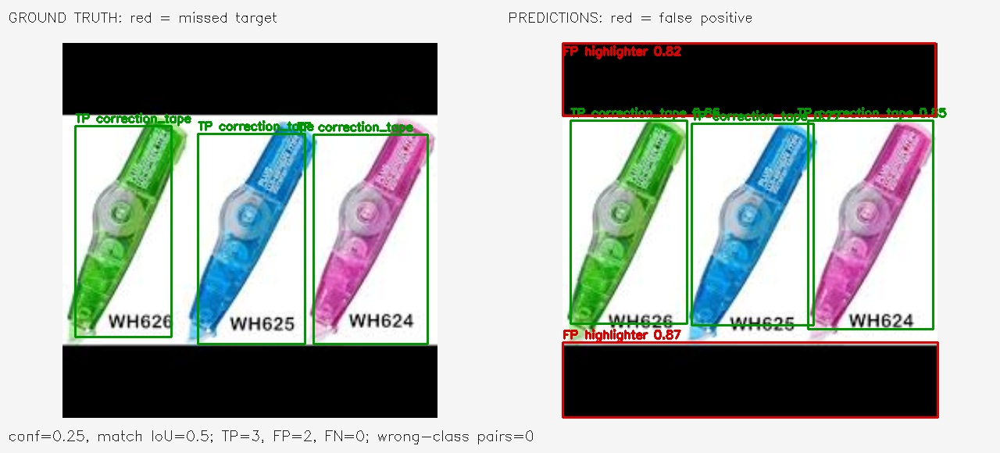
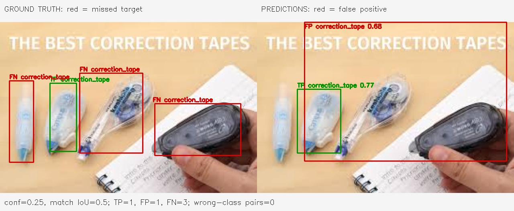
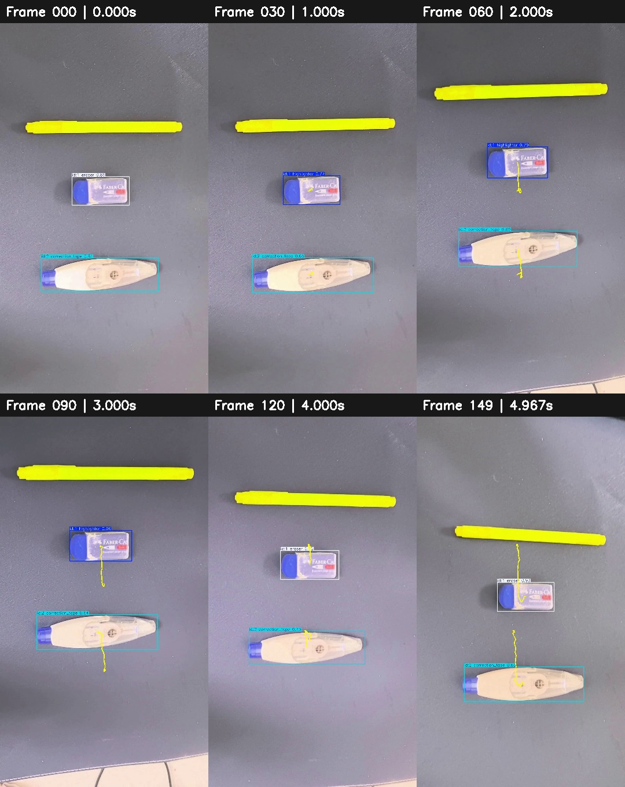

# YOLOv8 문구류 객체 감지 및 추적 — 학습·평가·추적 결과보고서

> 2026-11-19 19:28 KST: 사용자 요청으로 로컬 CPU 학습을 일시정지했다. 메모리와 체크포인트를 보존했으며 이후에도 재개하지 않았다.

> 이후 사용자는 교수님 자료를 별도 기록하고 Colab에서 학습하도록 지시했다. [과제 지침 메모](../docs/ASSIGNMENT_GUIDELINES.md)와 [Colab 실행 노트북](../notebooks/train_colab.ipynb)을 사용하며, Colab의 실제 환경·데이터 검증 결과와 이전 CPU 시도를 구분해 기록한다.

기록일: 2026-11-20 (Asia/Seoul)

저장소: https://github.com/jeongjunseo/yolov8-stationery-tracking

**현재 상태: Colab Tesla T4의 CUDA 장치 0에서 batch 16으로 100 epoch 학습과 test 평가를 완료했다. Test 73장·108개 정답 객체에서 Precision 93.70%, Recall 88.77%, mAP50 93.58%, mAP50-95 76.68%를 얻었다. 사용자가 제공한 실제 영상으로 5초 결과 영상과 궤적 CSV도 생성했다. 다만 실제 형광펜 미검출과 지우개/형광펜 오분류가 남아 세 물체의 정확한 감지·추적 목표는 미달성이다. 파일 생성과 추적 성능을 구분해 보고한다. 로컬 CPU 학습은 사용자 요청에 따른 일시정지 상태를 유지한다.**

## 1. 목적과 현재 결과

YOLOv8n으로 형광펜(`highlighter`, ID 0), 수정테이프(`correction_tape`, ID 1), 지우개(`eraser`, ID 2)를 학습하고, 별도 test split에서 성능을 평가한 뒤 ByteTrack으로 클래스명·추적 ID·이동 궤적이 표시되는 5초 영상을 만드는 것이 목표이다.

이전 컴퓨터의 `HANDOFF.md`를 기준으로 작업을 재개했다. 저장소를 복제하고 제공된 `data.zip`에서 기존 분할 데이터를 복원했다. 데이터와 라벨을 새로 만들거나 재분할하지 않았다. 로컬 PC에서는 NVIDIA GPU가 확인되지 않아 사용자의 승인으로 CPU 학습을 시도했으며, 이후 일시정지하고 사용자 지시에 따라 Colab GPU로 실행 환경을 전환했다. 완료된 모델로 사용자가 나중에 업로드한 실제 영상을 로컬 CPU에서 추론했다. 이번 보고서는 학습·평가 결과와 실제 영상에서 드러난 실패를 함께 다룬다.

## 2. 데이터 출처와 전처리

학습 이미지 데이터는 직접 촬영한 데이터라고 주장하지 않는다. [data/SOURCES.md](../data/SOURCES.md)에 기록된 Roboflow Universe의 세 공개 데이터셋을 사용하며 원본은 CC BY 4.0으로 명시되어 있다. 직접 촬영 기기·기간·라벨링 경험은 제공된 근거가 없어 기재하지 않았다. 별도로 제공받은 실제 추적용 영상은 6절에 기록한다.

| 클래스 | 출처 | 원본 이미지 | 기존 처리 |
|---|---|---:|---|
| highlighter | [Highlighter](https://universe.roboflow.com/visioncoprocessor/highlighter-g3fru) | 240 | 폴리곤 라벨을 검출 박스로 변환 |
| correction_tape | [Assignment_Correction tape](https://universe.roboflow.com/kyonggiuniv/assignment_correction-tape) | 129 | 경계를 조금 벗어난 박스 6개를 이전 작업에서 보정 |
| eraser | [eraser](https://universe.roboflow.com/reder/eraser-xnm4s) | 318 | 세 색상 클래스를 eraser로 통합 |

원본 파일명에는 데이터셋별 접두어가 붙어 있다. 위 전처리는 이전 인계 문서에 기록된 내용이며 이번 실행에서 반복하지 않았다.

## 3. 복원 및 데이터 검사

| 구분 | train | valid | test | 합계 |
|---|---:|---:|---:|---:|
| 이미지 수 | 498 | 116 | 73 | 687 |
| 이미지 비율 | 72.49% | 16.89% | 10.63% | 100% |
| 라벨 파일 수 | 498 | 116 | 73 | 687 |
| 객체 박스 수 | 614 | 146 | 108 | 868 |
| 빈 라벨 파일 수 | 15 | 4 | 2 | 21 |

비율은 소수 둘째 자리 반올림 때문에 합계가 100.01%로 보일 수 있다.

다음 표의 각 셀은 **클래스 포함 이미지 수 / 객체 박스 수**이다.

| 클래스 | train | valid | test | 전체 |
|---|---:|---:|---:|---:|
| highlighter | 177 / 180 | 21 / 21 | 21 / 23 | 219 / 224 |
| correction_tape | 89 / 163 | 26 / 52 | 14 / 44 | 129 / 259 |
| eraser | 217 / 271 | 65 / 73 | 36 / 41 | 318 / 385 |

`python scripts/check_dataset.py`는 정상 종료했다. 기존 스크립트가 검사하는 이미지·라벨 대응, 좌표 범위, 클래스 구성, split 간 완전 중복 검사에 통과했다. 별도 Pillow 검사로 이미지 687장 전체를 실제 디코딩했고 오류는 0건이었다. 대응 라벨 파일 누락도 0건이었다. 상세 집계는 [dataset_summary.json](../outputs/dataset_summary.json)에 저장했다.

Colab에서는 2,451,554,279 bytes의 기존 데이터 ZIP을 25개 조각에서 복원했다. 조각 목록과 전체 SHA-256을 검증했고, 이미지·라벨 1,374개와 메타데이터 2개를 포함한 1,376개 파일의 매니페스트 검사가 통과했다. 두 메타데이터 파일은 Windows/Linux 개행 차이만 동등하게 인정해 저장소의 파일을 유지했다. Colab에서 다시 실행한 데이터 검사도 train 498장, valid 116장, test 73장으로 통과했다. 근거는 [colab_dataset_check.json](../outputs/colab_dataset_check.json)이다.

### 빈 라벨과 남은 데이터 품질 문제

highlighter 원본 240장 중 21장의 라벨 파일이 비어 있어 해당 클래스의 라벨 포함 이미지는 219장이다. 빈 라벨 파일이 있다는 사실만으로 올바른 배경 이미지라고 판단할 수 없다.


연락시트 02번 train 이미지 `highlighter_IMG_20260713_162103695_HDR_jpg.rf.Sbrd0MiyGuUjja7V5nXf.jpg`에는 왼쪽 가장자리에 녹색 뚜껑의 형광펜이 보이는데 라벨은 비어 있다. 최소 이 사례는 누락 객체 라벨 검토 대상이다. 이번 실행은 기존 데이터 보존 원칙에 따라 원본 라벨을 그대로 사용하며, 이 문제를 결과 해석의 한계로 기록한다. 이 사례는 학습 모델의 미검출 사례가 아니라 **정답 데이터의 문제**이다.

나머지 빈 라벨도 썸네일 검토만 했으므로 원해상도에서의 정답 완전성을 보증하지 않는다.

### Split 간 유사 장면 검사와 평가의 한계

학습 중 기존 파일을 변경하지 않고 이미지 687장의 split 간 조합 102,590쌍을 추가로 비교했다. SHA-256이 같은 완전 중복 쌍은 0개였다. 유사 후보는 64비트 pHash 해밍 거리 ≤ 6, 128비트 dHash 거리 ≤ 12, 32×32 RGB 평균 절대 차이 ≤ 12라는 세 조건을 모두 만족하는 쌍으로 선별했다. 결과와 방법은 [near_duplicate_audit.json](../outputs/dataset_audit/near_duplicate_audit.json), 이미지별 해시는 [near_duplicate_image_hashes.json](../outputs/dataset_audit/near_duplicate_image_hashes.json)에 기록했다.

| 서로 다른 split | 자동 선별된 유사 후보 쌍 |
|---|---:|
| train–valid | 239 |
| train–test | 210 |
| valid–test | 45 |
| 합계 | 494 |

494쌍은 모두 eraser 이미지 쌍이었다. 이 후보에 포함된 고유 이미지는 train 136장, valid 54장, test 30장이며, test 29장은 train 이미지와 후보 관계에 있었다. 한 이미지가 여러 후보 쌍에 참여할 수 있으므로 쌍의 수와 이미지 수는 다르다. 다른 클래스에서 후보가 없었다는 결과만으로 그 클래스의 장면 독립성이 입증되지는 않는다.

유사도가 높은 순서에서 같은 이미지를 재사용하지 않고 선택한 12쌍(train 12장·valid 6장·test 6장)을 [연락시트 1](../outputs/dataset_audit/near_duplicate_candidates_01.jpg)과 [연락시트 2](../outputs/dataset_audit/near_duplicate_candidates_02.jpg)로 시각 검토했다. 이 표본에서는 배경·물체 배치·시점이 거의 같은 장면이 서로 다른 split에 분포하는 것을 확인했다. 유사도순으로 선택했기 때문에 이 검토 결과를 전체 494쌍의 중복 비율로 확대해석하지 않는다.

별도로 [임계값 근처 6쌍](../outputs/dataset_audit/near_duplicate_threshold/near_duplicate_candidates_01.jpg)을 검토했을 때는 같은 배경에서도 물체 회전·시점 변화가 뚜렷한 사례가 있었다. 따라서 **494쌍은 자동 선별 후보 수이며 확정 중복 수가 아니다.** 해시 기반 방법은 단순한 배경 때문에 유사도를 높게 평가하거나, 반대로 잘림·회전·시점 변화가 있는 같은 장면을 놓칠 수 있다. 파일명 시각도 실제 촬영 메타데이터로 인증된 것은 아니다.

18쌍의 개별 시각 판정과 원본 보존 검사는 [near_duplicate_visual_review.json](../outputs/dataset_audit/near_duplicate_visual_review.json)에 기록했다. 이미지·라벨 1,374개 파일의 SHA-256이 원본 ZIP 매니페스트와 모두 일치했으며, 이번 학습의 데이터·라벨·설정은 변경하지 않았다.

이 발견은 특히 eraser의 validation·test 성능이 새로운 장면에서의 성능보다 낙관적으로 나타날 수 있음을 의미한다. 그 영향의 크기나 성능 순위에 미친 원인은 아직 측정하지 않았으므로 확정하지 않는다. 현재 실행은 기존 분할을 유지한 기준 실험으로 보고하며, 이 한계를 성능과 함께 제시한다.

후속 실험에서는 촬영 세션·장면 단위로 이미지를 묶고 같은 그룹을 하나의 split에만 배치해야 한다. 누락 라벨도 검토한 뒤 동일한 학습 설정으로 별도 실험을 수행해 현재 기준 실험과 비교하는 것이 필요하다. 이번 기준 실험에서는 분할을 바꾸거나 데이터를 삭제하지 않았다.

## 4. 실행 환경과 학습 설정

### 현재 Colab 환경과 실행 조건

| 항목 | 확인 결과 또는 실행 설정 |
|---|---|
| 실행 환경 / Python | Google Colab / 3.13.16 |
| GPU | Tesla T4, 런타임 보고 메모리 15,637,086,208 bytes |
| PyTorch / torchvision | 2.14.1+cu130 / 0.29.1+cu130 |
| CUDA 런타임 / 사용 가능 | 13.0 / True |
| Ultralytics / OpenCV / PyYAML | 8.4.215 / 4.14.0.94 / 6.0.3 |
| 모델 / epochs / imgsz | YOLOv8n / 100 / 640 |
| 요청 batch / 실제 batch / device | 16 / 16 / cuda:0 |
| workers 인자 / seed / deterministic | 4 / 42 / True |
| optimizer 설정 / AMP / cache | auto / True / False |
| 완료 epoch / 학습 CSV 누적 시간 | 100 / 9,834.78초 (2시간 43분 54.78초) |

실제 환경은 [colab_environment.json](../outputs/colab_environment.json), 실행 설정은 [args.yaml](assets/train/args.yaml)에 저장했다. 기존 `scripts/train.py`의 설정을 유지했다. [학습 완료 기록](../outputs/colab_training_run.json)과 [시도 기록](../outputs/colab_training_attempts.json)은 batch 16의 단일 시도 성공과 CUDA 사용, 100 epoch 완료를 확인한다. GPU 메모리 부족이나 batch 축소는 없었고, [100회 백업 기록](../outputs/colab_backup_events.json)에 실패가 없다. 시간은 학습 CSV에 기록된 누적 값이며 환경 설치·데이터 전송·후속 평가 시간은 포함하지 않는다.

```text
python scripts/train.py --device 0 --batch 16 --epochs 100
```

첫 Drive 연결 시도는 `ValueError: mount failed`로 끝났으나 사용자가 정상 연결 절차로 다시 실행한 뒤 `Mounted at /content/drive`와 백업 폴더 생성을 확인했다. 최초 오류의 세부 원인은 확정하지 않았다. Colab의 `pip check`는 기존 IPython 7.34.0에서 `jedi`가 누락됐다는 경고를 출력했다. 이후 핵심 패키지 import와 CUDA 확인은 통과했으며, 전체 의존성 검사가 모두 통과했다고 기록하지 않는다.

### 학습 곡선과 최종 모델 검증


[results.csv](assets/train/results.csv)는 epoch 1부터 100까지 100행을 포함한다. 학습 box loss는 0.94820에서 0.37691로, validation box loss는 0.88072에서 0.53754로 감소했다. Validation mAP50-95는 첫 epoch 0.56468에서 마지막 epoch 0.82376으로 상승했으며, CSV 최고값은 epoch 88의 0.82416이다. 이 값은 validation 결과이며 아래 test 결과와 구분한다. CSV 최고값만으로 저장된 모델의 선택 epoch를 단정하지 않는다.

[models/best.pt](../models/best.pt)는 6,500,778 bytes, 파라미터 3,138,489개이며 SHA-256은 다음과 같다.

```text
72eec58f57a0decd694a98606e9759824cb7cb4d75af345e9ae8db735a4d66ea
```

해시는 Colab 완료 기록과 일치했다. 이 PC의 새 가상환경에서 모델을 CPU로 불러와 클래스 ID 0·1·2와 이름을 확인했고, 읽기 전후 파일 해시가 같았다. 학습·평가·실패 분석 그림 42개의 이미지 무결성 검사도 통과했다. [artifact_verification.json](../outputs/artifact_verification.json)에 ZIP 검증, 모델 로딩, 100행 CSV, 지표 범위 및 파일 크기 검사 결과를 남겼다. 이는 저장된 결과 검증이며 로컬에서 학습이나 test 평가를 다시 실행한 결과는 아니다.

### 이전 로컬 CPU 시도 — 사용자 요청으로 일시정지

| 항목 | 확인 결과 |
|---|---|
| 실행 환경 | Windows, 새 Python 3.14.0 가상환경 |
| CPU | AMD Ryzen 5 5500GT, 6코어 / 12스레드 |
| 그래픽 | AMD Radeon(TM) Graphics, Parsec 가상 디스플레이 |
| NVIDIA GPU / nvidia-smi | 장치 확인 안 됨 / 명령 및 표준 경로에 없음 |
| 시스템 PyTorch | 2.9.0+cu126, CUDA 12.6 빌드 |
| 시스템 CUDA 인식 | False, 장치 수 0 |
| 새 가상환경 PyTorch / Ultralytics | 2.15.0+cpu / 8.4.215 |
| 새 가상환경 torchvision / OpenCV | 0.29.2 / 4.14.0.94 |
| 새 가상환경 CUDA 인식 | False, 장치 수 0 |
| 가상환경 위치 | 프로젝트 `.venv`에서 D:의 새 환경으로 연결 |

이전 PC의 `.venv`를 사용하지 않았다. 이번 새 환경의 첫 의존성 설치는 C: 공간 부족으로 실패했고, 해당 불완전 환경을 D:에 보존한 뒤 D:에 새 환경을 구성했다. 기존 사용자 파일을 삭제하지 않았다. 시스템 CUDA 빌드가 설치되어 있어도 NVIDIA 하드웨어가 없어 CUDA를 사용할 수 없다는 점을 확인했다.

로컬의 새 환경에서는 `requirements.txt` 설치와 `pip check`가 성공했다. 사용자가 CPU 학습을 허용한 후 이 CPU 빌드로 학습을 실행했다. [로컬 환경 확인 JSON](../outputs/environment_check.json)에 실제 버전과 CUDA 상태를 저장했다. 이 검사 결과와 아래 CPU 설정은 위 Colab 환경의 결과와 구분한다.

최초 CPU 실행은 기존 `scripts/train.py`에서 장치만 `cpu`로 지정했다. 실제 메모리 부족 발생에 따라 batch만 16에서 8, 다시 4로 낮췄다.

| 항목 | 설정 |
|---|---|
| 모델 | COCO 사전 학습 YOLOv8n (`yolov8n.pt`) |
| epochs / imgsz | 100 / 640 |
| batch | 16과 8에서 CPU 메모리 부족 발생 후 4로 재시도 |
| workers | 스크립트 인자 4 / Ultralytics CPU 실행 실제값 0 |
| seed / deterministic | 42 / True |
| device | cpu (사용자 명시적 승인) |
| optimizer | auto → 실제 선택 AdamW |
| 실제 초기 학습률 | 0.001429 |

```powershell
python scripts/train.py --device cpu --batch 4 --epochs 100
```

학습 로그와 체크포인트는 프로젝트의 `runs/`를 통해 D:에 저장한다. 최초 실행은 2026-11-19 19:17:51 KST에 시작했으나 19:18:27 KST에 `DefaultCPUAllocator: not enough memory` 오류로 종료됐다. 오류 메시지의 할당 요청 크기는 13,107,200 bytes이며 첫 epoch 결과는 생성되지 않았다. 사용자 프로그램이나 데이터를 삭제·변경하지 않고, 메모리 부족 시 batch를 낮추는 대응을 승인된 CPU 실행에 적용했다. 실패 로그와 상태는 `runs/session_cpu_20261119/`에 보존했다.

batch 8 재시도는 19:20:06 KST에 시작했으나 첫 epoch의 11/63 배치에서 CPU 메모리 부족으로 실패했고, 19:21:02 KST에 종료됐다. 할당 요청 크기는 16,384,000 bytes였다. 이 시도에서도 완료 epoch는 0개이며, 로그와 `status.json`은 `runs/session_cpu_20261119_b8/`에 보존했다.

batch 4 재시도는 19:22:27 KST에 시작해 1 epoch를 완료했다. 2번째 epoch 44%에서 19:28 KST 사용자 요청으로 프로세스를 일시정지했고, 메모리·체크포인트·로그를 보존했다. 상태는 로컬 전용 `outputs/training_status.json`에 기록되어 있으며, 로그는 `runs/session_cpu_20261119_b4/`, 결과 디렉터리는 `runs/train/stationery-3/`이다. 이 중간 결과를 완료된 Colab 모델이나 test 성능으로 사용하지 않는다.

## 5. Test 성능과 실제 실패 사례

Colab에서 100 epoch 학습 완료 후 `python scripts/evaluate.py --device 0`으로 `models/best.pt`를 평가했다. Test split은 73장·정답 객체 108개이며, [test_metrics.json](../outputs/test_metrics.json)에 전체·클래스별 실측값을 저장했다. 아래 성능 수치는 %로 표시하고 소수 둘째 자리로 반올림했다.

| 클래스 | 정답 객체 | Precision | Recall | mAP50 | mAP50-95 |
|---|---:|---:|---:|---:|---:|
| 전체 (클래스 평균) | 108 | 93.70 | 88.77 | 93.58 | 76.68 |
| highlighter | 23 | 89.07 | 91.30 | 93.68 | 87.09 |
| correction_tape | 44 | 93.06 | 75.00 | 87.56 | 48.35 |
| eraser | 41 | 98.98 | 100.00 | 99.50 | 94.60 |

전체 mAP75는 **80.10%**이다. mAP50은 IoU 0.5에서의 AP를 클래스 평균한 값이며, mAP50-95는 IoU 0.50부터 0.95까지 0.05 간격의 10개 기준과 클래스를 평균한다. AP는 신뢰도에 따른 precision–recall 곡선으로 계산한다. 표의 precision·recall은 평활화한 클래스 평균 F1이 최대가 되는 공통 신뢰도 지점에서 구한 클래스 평균으로, confidence 0.25의 단일 임계값 결과가 아니다. 클래스 행은 `ap_class_index`로 대응시켜 저장했으며 세 클래스 모두 평가됐다.

### Test 그래프와 클래스별 차이


혼동 행렬은 가로축이 정답, 세로축이 예측이다. 이 실행의 Ultralytics 8.4.215 혼동 행렬은 confidence > 0.001의 예측을 집계한 반면, 표의 precision·recall은 평활화한 클래스 평균 F1이 최대가 되는 공통 신뢰도 지점에서 계산한 클래스 평균이므로 행렬의 단순 비율과 일치하지 않는다. 또한 공식 평가의 NMS IoU 0.7과 아래 진단의 0.5는 다르다. [F1 곡선](assets/test/BoxF1_curve.png)과 [정규화 혼동 행렬](assets/test/confusion_matrix_normalized.png)도 함께 저장했다.

- **수정테이프:** Recall 75.00%, mAP50-95 48.35%로 가장 낮다. mAP50에서 mAP50-95로 39.21%p 하락했고, 아래 그림에서는 이웃 객체를 묶은 박스·물체 일부만 잡은 박스가 확인됐다. 엄격한 IoU에서 위치 정확도가 주요 약점임을 시사한다. Train 포함 이미지가 89장으로 형광펜 177장·지우개 217장보다 적고, test는 14장에 44객체로 여러 물체가 함께 있는 장면이 많다. 이 차이는 설명 후보이며 데이터량 하나를 성능 차이의 원인으로 확정하지 않는다.
- **형광펜:** mAP50-95 87.09%이나 검은 띠를 형광펜으로 검출한 배경 오검출과, 복잡한 배경 속 작은 정답 박스를 놓친 사례가 있다. 높은 전체 점수가 모든 장면의 검출을 보장하지 않는다.
- **지우개:** mAP50-95 94.60%로 가장 높다. 그러나 3절에서 확인한 split 간 거의 같은 장면이 평가를 낙관적으로 만들 수 있다. 새로운 배경·배치에 대한 일반화 성능이나 다른 클래스보다 본질적으로 쉬운 문제라고 단정할 수 없다.

### 고정 임계값에서의 오류 진단

[failure_analysis.json](../outputs/failure_analysis.json)은 공식 AP와 별도로 confidence 0.25, NMS IoU 0.5, imgsz 640, rect=False에서 예측했다. 같은 클래스의 정답·예측 박스를 IoU ≥ 0.5 조건으로 IoU가 큰 순서대로 일대일 매칭했다. 이 기준에서 test 73장 중 10장에 하나 이상의 FP 또는 FN이 있었다.

| 클래스 | TP | FP | FN |
|---|---:|---:|---:|
| highlighter | 21 | 3 | 2 |
| correction_tape | 33 | 7 | 11 |
| eraser | 41 | 0 | 0 |
| 합계 | 95 | 10 | 13 |

객체 수를 합산한 micro precision은 90.48%, recall은 87.96%이다. 평가 임계값·전처리·집계 방식이 달라 위 공식 지표와 직접 대체할 수 없다. 미매칭 박스 사이에서 정의된 다른 클래스 중첩 쌍은 0개였지만, 이는 배경을 다른 클래스로 잘못 검출한 FP가 없다는 뜻이 아니다. Test를 이용해 임계값을 재선택하거나 현재 모델을 재학습하지 않았다.

오류가 있는 클래스별 대표 이미지와 오류 수가 많은 이미지를 우선해 총 9장을 저장하고 시각 검토했다. 이는 오류 사례 모음이며 test 전체의 무작위 표본이 아니다. 다음은 실제 관찰 결과다.

| 그림 | 관찰한 현상 | 진단 결과 |
|---|---|---|
| [01](assets/failures/failure_01.jpg) | 수정테이프 3개는 검출했으나 위·아래 검은 띠를 형광펜으로 검출 (신뢰도 0.82 / 0.87) | TP 3, FP 2 |
| [02](assets/failures/failure_02.jpg) | 손·텍스트가 있는 제품 합성 이미지에서 여러 물체와 배경을 묶은 큰 박스 | TP 1, FP 1, FN 3 |
| [03](assets/failures/failure_03.jpg) | 인접한 수정테이프를 함께 덮는 큰 박스와 누락 | TP 3, FP 1, FN 3 |
| [04](assets/failures/failure_04.jpg) | 길쭉한 수정테이프 하나를 두 부분으로 나눠 검출 | FP 2, FN 1 |
| [05](assets/failures/failure_05.jpg) | 촘촘한 제품 배열에서 여러 개를 묶은 큰 박스와 좌하단 누락 | TP 9, FP 2, FN 1 |
| [06](assets/failures/failure_06.jpg) | 포장 안 오른쪽 제품의 일부만 작은 박스로 검출해 IoU 기준 미달 | TP 1, FP 1, FN 1 |
| [07](assets/failures/failure_07.jpg) | 나뭇가지·잎 주변 작은 정답 박스 2개 모두 미검출 | FN 2 |
| [08](assets/failures/failure_08.jpg) | 손에 잡혀 일부가 가려진 오른쪽 제품 누락 | TP 3, FN 1 |
| [09](assets/failures/failure_09.jpg) | 화면 왼쪽 아래 경계에서 잘린 부분 제품 누락 | TP 4, FN 1 |



그림 01은 배경 단서에 대한 취약성을 보여준다. 이 관찰만으로 특정 학습 이미지가 원인이라고 확정하지는 않는다.



그림 02와 03·04·06은 분류 정답 여부뿐 아니라 객체별 박스 범위와 위치가 중요함을 보여준다. IoU가 기준에 못 미치는 박스는 FP와 FN으로 함께 집계될 수 있다.


그림 07의 원본 해상도는 6,144 × 8,192이다. 긴 변을 640으로 축소하면 두 정답 박스는 대략 18 × 24, 47 × 28 픽셀 크기가 된다. 작은 입력상 크기와 주변 배경이 관찰되지만 각각의 원인 기여도는 별도 실험하지 않았다. 9개 실패 그림에서 추가 정답 라벨 오류를 확정하지 않았으며, 앞서 확인한 빈 train 라벨 문제와 구분한다.

## 6. 실제 5초 영상의 추적 결과와 한계

### 원본 영상과 HDR 전처리

사용자가 업로드한 `1000030242.mp4`를 사용했다. 원본은 프로젝트 상위 폴더에 보존했으며, 파일 크기는 26,398,062 bytes, SHA-256은 다음과 같다.

```text
c284b4cc16c9d19368e8c427e81b143c40e5bd4e754cc63b8dfebe22638531a2
```

원본은 HEVC 10-bit, PQ 전송함수·BT.2020 색상 정보가 있는 HDR 영상이다. 회전 메타데이터는 -90도이며 표시 방향은 1080 × 1920, 길이는 9.566089초, 프레임 수는 287이다. 원본을 바꾸지 않고 FFmpeg 9.0.2 gyan 빌드의 `zscale`·`tonemap=mobius`로 SDR BT.709 입력을 별도 생성했다. 변환은 선형 RGB 처리 후 BT.709로 저장하며, 방법은 [FFmpeg tonemap 문서](https://ffmpeg.org/ffmpeg-filters.html#tonemap), Windows 빌드 출처는 [공식 다운로드 페이지](https://ffmpeg.org/download.html)에 연결된 gyan.dev이다. 원본 방향 메타데이터 처리와 아래의 추가 추론 회전은 별개의 단계다.

정확한 전처리·추론·H.264 재인코딩 명령은 [README 6절](../README.md#6-5초-추적-영상-제작)에 기록했다. 중간 SDR 입력, OpenCV 렌더링, 이전 시도의 영상·CSV는 로컬에 보존했고 원본 영상은 Git에서 제외했다.

### 추론 설정 선택과 추적 구현

완료된 `models/best.pt`를 그대로 사용했다. 학습·데이터·공식 test 평가를 변경하지 않았고 추가 학습은 실행하지 않았다. 실제 영상 추론은 로컬 CPU에서 수행했으며, 이전에 일시정지한 CPU 학습을 재개하지 않았다.

동일 영상의 프레임 0·75·149에서 원본/SDR 입력 2종 × imgsz 640/1280 × 회전 0/90도의 조합을 총 24회 진단했다. 이 표본 진단은 confidence 0.01까지 관찰했고, 이후 앞 5초 전체는 모두 confidence 0.25, NMS IoU 0.5로 다음과 같이 비교했다. [tracking_experiments.json](../outputs/tracking_experiments.json)에 각 시도의 설정과 수치를 남겼다. 행 수는 반복 프레임의 예측 기록 수이며 실제 객체 수나 정확도가 아니다.

| 전체 5초 실행 | CSV 행 수 | 관찰 |
|---|---:|---|
| 원본, imgsz 640, 회전 0, 일반 NMS | 117 | correction_tape 114 / highlighter 3 / eraser 0행 |
| SDR, imgsz 640, 회전 0, 일반 NMS | 13 | correction_tape 9 / highlighter 4 / eraser 0행 |
| SDR, imgsz 1280, 회전 90, 일반 NMS | 410 | 14개 ID, 겹치는 다른 클래스 예측이 남음 |
| SDR, imgsz 1280, 회전 90, class-agnostic NMS | 300 | 최종 선택: ID 2개, 분류 오류는 남음 |

이 비교는 실제 영상을 보며 선택한 탐색 결과이므로 새로운 영상에서 재현될 개선이나 별도 검증된 일반화 성능으로 해석하지 않는다. SDR 변환만으로 검출이 개선되지는 않았고, 추가 입력 크기·방향 변경과 겹치는 박스 억제가 필요했다. 최종 설정은 다음과 같다.

| 항목 | 실제 설정 |
|---|---|
| 모델 / device | 기존 best.pt / cpu |
| 입력 | 별도 SDR BT.709 영상 |
| imgsz / 추론 회전 | 1280 / 시계방향 90도 |
| confidence / NMS IoU | 0.25 / 0.5 |
| agnostic_nms | True — 클래스가 달라도 겹치는 박스 억제 |
| 추적기 / 상태 유지 | ByteTrack (`bytetrack.yaml`) / persist=True |
| 궤적 길이 | 최근 중심 좌표 60개 |
| 처리 범위 | 입력의 첫 5초, 150프레임 |

추론 입력만 회전하고 예측 박스·중심 좌표를 원래 세로 영상 좌표로 되돌린다. 모델이 낸 ID·클래스·신뢰도는 유지하며 실제 물체에 맞춘 수동 박스나 클래스 수정은 하지 않았다. ByteTrack은 프레임 사이 ID를 연결하며 별도 Re-ID 모델을 사용하지 않는다. `lap` 0.5.14를 새 환경에 설치하고 요구사항에도 반영했다. 기본 추적기 설정의 낮은 임계값은 0.1이지만, 이 실행은 confidence 0.25 미만의 예측을 추적기 전달 전에 제외하므로 0.1–0.25 구간의 낮은 신뢰도 연결 효과를 사용한 결과는 아니다.

### 최종 영상과 CSV에서 확인한 현상

[5초 결과 영상](../outputs/final_5s.mp4) · [프레임별 궤적 CSV](../outputs/trajectory.csv)



| 실제 물체 | ID | 150프레임의 예측 기록 | 해석 |
|---|---:|---|---|
| 지우개 | 1 | eraser 82행 + highlighter 68행 | 같은 ID에서 클래스 16회 변경 |
| 수정테이프 | 2 | correction_tape 150행 | 모든 프레임에 같은 ID와 클래스 기록 |
| 위쪽 노란 형광펜 | 없음 | 검출·궤적 없음 | 미검출로 추적 불가 |

CSV에는 총 300행과 두 ID가 있고, 각각 프레임 0부터 149까지 누락 없이 한 번씩 기록된다. `highlighter`라는 예측이 등장한 68행은 실제 형광펜을 찾은 결과가 아니라 지우개 오분류다. 따라서 **세 클래스 문자열이 CSV에 존재한다는 사실을 세 실제 물체의 추적 성공으로 보고하지 않는다.** Class-agnostic NMS는 중복 박스와 ID 수를 줄였지만 올바른 클래스를 보장하지 않았다.

영상에서는 물체가 대체로 놓여 있는 상태에서 카메라가 움직인다. 노란 궤적은 검출 중심점의 화면 픽셀 좌표 변화이며, 실제 공간의 물체 이동 거리나 경로를 나타내지 않는다. 카메라 움직임 보정이나 실제 길이 단위 환산은 수행하지 않았다.

이 사례는 공개 이미지 test 성능과 실제 촬영 영상 사이의 차이를 보여준다. 촬영 물체의 외형·방향·배경·HDR 처리 조건이 기존 데이터와 다르지만 각 요인의 영향을 분리 측정하지 않았으므로 실패 원인을 하나로 확정하지 않는다. IDF1·MOTA 같은 정식 추적 정확도도 측정하지 않았다. 향후 실제 형광펜·지우개를 다양한 방향·배경·가림 조건에서 수집하고 정확히 라벨링한 뒤, 촬영 장면별로 분리한 독립 평가 영상으로 별도 보완 학습을 검증해야 한다. 이번 결과의 파일을 만들기 위해 원래 학습을 바꾸지는 않았다.

### 파일 형식·시간·좌표 검증

최종 MP4는 H.264/yuv420p, 1080 × 1920, 30 FPS, 150프레임, 오디오 스트림 0개이며 컨테이너 재생 길이는 정확히 5초다. 영상은 8,644,494 bytes, CSV는 13,363 bytes이다. 출력 프레임 수 `N=round(입력 FPS×5)`와 출력 FPS `N/5`를 사용하고 CSV도 같은 출력 시간축을 따른다. CSV 마지막 행의 시간 4.9667초는 마지막 프레임 시작 시각 `149/30`을 반올림한 값이므로 5초 영상과 모순되지 않는다.

원본과 중간 렌더링을 보존한 채 별도 H.264 파일로 인코딩했다. `-n`과 스크립트의 기존 파일 검사가 덮어쓰기를 막는다. [tracking_verification.json](../outputs/tracking_verification.json)의 20개 검사가 모두 통과했다. 중간·최종 영상 모두 150프레임을 디코딩했으며 PTS는 0부터 4.966667초, 마지막 프레임 종료 시각은 5초였다. CSV의 중복 frame–ID, 시간 순서, 좌표 범위와 입력 파일 무변경도 확인했다.

CSV의 ID별 최근 60개 중심 좌표로 예상 궤적을 만들고 실제 노란 선과 대조했다. 궤적이 존재하는 149프레임에서 2픽셀 허용 범위의 평균 포함률은 1.0이었다. 배경의 노란색 때문에 포함률이 높아질 수 있어 이 값은 렌더링과 CSV의 대응 근거이며 물체 분류·물리적 정체성의 정확도를 입증하지 않는다. 프레임 0·30·60·90·120·149도 시각 검토했다. 파일·시간·좌표 검증은 통과했지만 JSON의 `all_three_physical_objects_correctly_tracked`와 `tracking_accuracy_goal_met`는 모두 `false`이다.

기존 합성 영상 회귀 테스트는 29.97 FPS 입력의 150프레임·30 FPS·5초 출력과 CSV 시간을 검사했다. 추가 회전 좌표 복원 검사도 수행했으나, 이런 모의 검출 기반 테스트는 실제 물체의 분류나 ID 유지 성능을 입증하지 않는다. 실제 영상 관찰 결과와 구분한다.

## 7. 이번 작업에서 확인한 내용

1. 데이터 파일이 Git에서 제외되어 있으므로 저장소 복제만으로 학습 자료가 준비되지 않는다. 이번에는 별도로 있던 `data.zip`의 기존 분할을 복원할 수 있었다.
2. 라벨 구문·좌표 검사와 이미지 디코딩은 통과해도 라벨 누락을 의미적으로 찾아내지는 못한다. 빈 라벨 연락시트에서 실제 형광펜이 보이는 사례를 발견했다.
3. CUDA 지원 PyTorch 설치와 CUDA 사용 가능한 하드웨어는 별개의 조건이다. 이 PC의 CUDA 빌드는 장치를 인식하지 못했다.
4. 저장 공간 부족은 패키지 설치도 중단시킨다. 원본을 삭제하지 않고 여유 있는 D:에 새 환경을 구성했다.
5. 소수 FPS 영상에서 프레임 수만 반올림하면 정확히 5초가 되지 않을 수 있다. 출력 시간축과 CSV 시간을 함께 맞춰야 한다.
6. 감지는 프레임의 클래스·박스를 예측하고, 추적은 시간에 따라 ID를 연결한다. 검출 정확도와 추적 ID 유지 성능은 각각 실험해야 한다.
7. 바이트 단위 완전 중복이 없어도 거의 같은 장면이 train·valid·test에 나뉠 수 있다. 추가 유사 장면 검사는 이 평가 한계를 드러냈으며, 자동 후보 수와 시각적으로 확인한 사례를 구분해 기록해야 한다.
8. Colab에서는 T4의 실제 CUDA 사용과 학습 기록을 확인한 뒤 100 epoch를 완료할 수 있었다. Drive 연결은 첫 실패 후 정상 재시도로 복구됐고, epoch별 백업은 100회 모두 성공했다. 브라우저 표시가 갱신되지 않을 때도 실제 CSV와 완료 JSON으로 진행 상태를 검증할 수 있었다.
9. mAP50이 높아도 수정테이프의 일부 박스·통합 박스 오류는 엄격한 IoU 평가에서 큰 차이를 만든다. 공식 AP/P/R, 저신뢰도 혼동 행렬, 고정 임계값 진단을 같은 지표로 읽지 않아야 한다.
10. HDR 영상을 SDR로 바꾸는 것만으로 모델의 검출 문제가 해결되지는 않았다. 실제 영상에서 입력 크기·방향·NMS를 비교했지만 형광펜 미검출과 지우개 오분류는 남았다. 기존 test 지표를 실제 영상 성능으로 대신 보고할 수 없다.
11. 두 ID가 모든 프레임에 이어져도 클래스가 16회 바뀔 수 있다. 궤적과 CSV의 일치, 안정적인 ID 번호, 올바른 물체 분류는 서로 다른 확인 항목이다. 카메라 이동으로 생긴 화면 궤적 역시 물체의 실제 이동과 구분해야 한다.

## 8. 제출물 상태와 다음 단계

| 제출물 | 현재 상태 |
|---|---|
| 공개 GitHub 저장소 | 공개 상태 확인 |
| 데이터 구성·검사 기록 | 작성 완료 |
| Colab GPU 환경·전송·데이터 검사 | 실제 JSON 기록 확보, 검사 통과 |
| [models/best.pt](../models/best.pt) | 100 epoch 완료, SHA-256·CPU 로딩·세 클래스 검증 통과 |
| [outputs/test_metrics.json](../outputs/test_metrics.json) | Test 73장·108객체 실측값 확보 |
| 학습·평가 성능 그래프 | [train](assets/train/)·[test](assets/test/) 경로에 실제 그래프·CSV·설정 저장 |
| 실패 분석 | [진단 JSON](../outputs/failure_analysis.json)과 [9개 시각 사례](assets/failures/) 검토 완료 |
| [outputs/final_5s.mp4](../outputs/final_5s.mp4) | 실제 영상으로 생성, H.264·150프레임·30 FPS·정확히 5초 확인 |
| [outputs/trajectory.csv](../outputs/trajectory.csv) | 300행·2개 ID, 시간·좌표·렌더링 대응 확인 |
| [영상 검증 기록](../outputs/tracking_verification.json) | 20개 파일·시간·좌표 검사 통과, 추적 성능 한계 명시 |
| 결과보고서 | 학습·평가·실제 영상·실패 분석 반영 완료 |
| 세 실제 물체의 정확한 감지·추적 | 미달성 — 형광펜 미검출, 지우개 클래스 변동 |

Colab 결과 ZIP의 CRC·경로·해시를 확인하고 모델·지표·그래프만 선택적으로 가져왔다. ZIP에 들어 있던 이전 README·보고서 사본으로 현재 문서를 덮어쓰지 않았다. ZIP 수집 당시의 문서 보완 대기 표시는 원본 수집 기록으로 보존하며, 최신 결과 설명은 이 보고서와 README를 기준으로 한다.

`runs/`가 Git에서 제외되므로 완료된 학습·평가·실패 그림과 영상 미리보기를 `report/assets/`에 저장했다. 현재 공개 결과 파일은 모두 GitHub 일반 push 제한 100 MiB 이내이며, 최대 파일은 8,644,494 bytes의 최종 영상이다. 앞선 모델·지표·그래프·보고서는 [결과 공개 커밋 4a1c727](https://github.com/jeongjunseo/yolov8-stationery-tracking/commit/4a1c72791f622667c0dff185a1154a6b689f9ce9)으로 push했다. 실제 영상·CSV·검증 기록과 보고서 갱신본은 [영상 결과 공개 커밋 29d8649](https://github.com/jeongjunseo/yolov8-stationery-tracking/commit/29d864994d8d86d4957244c71d417a535b39c04d)으로 추가 push했고 원격 main 일치를 확인했다. 이때 Git의 101개 추적 파일이 크기 제한 이내이고 모델·영상·CSV의 Git 저장 바이트 해시가 검증 기록과 일치함을 확인했다. 원본 데이터·사용자 원본 영상·로컬 환경은 Git에서 계속 제외한다.

요청된 모델·성능·영상·궤적·그래프·보고서 파일은 갖추었으며, 실패를 포함해 실제 실행 결과를 공개한다. 세 실제 물체를 모두 정확히 감지·추적하는 성능 목표는 아직 충족하지 못했으므로 실제 물체 데이터와 독립 영상으로 보완 실험이 필요하다. 로컬 CPU 학습은 일시정지 상태로 유지하며 위 기준 실험의 영상 제작 과정에서는 재학습하지 않았다. 기존 라벨·장면 독립성 문제와 같은 영상에서 추론 설정을 탐색했다는 점을 모두 현재 결과의 한계로 공개한다.

## 9. 후속 실험: 제공 영상의 프레임을 추가한 학습

사용자가 2026-11-20 제공 영상에서 이미지를 추출해 추가 학습하도록 요청했다. 위의 완료된 기준 실험을 보존하고 별도 보완 모델을 준비한다. 초기 가중치는 기존 `models/best.pt`이며, 영상의 SDR 프레임 48장(0.2초 간격)에 세 물체의 정답 박스를 검토해 추가한다. 기존 모델의 잘못된 예측 클래스를 그대로 정답으로 사용하지 않는다.

기존 train 498장과 새 프레임 48장을 합쳐 546장으로 학습하고, 기존 validation 116장과 test 73장은 유지한다. Colab run `20261120T123735Z_2e0735a1`에서 실제 T4·CUDA와 데이터 검증, 97 epoch 완료·97회 성공한 Drive 백업을 확인했다. batch 16, epochs 100, imgsz 640, seed 42와 나머지 기존 설정을 유지하며, 보완 가중치와 지표는 `models/video_finetune/`, `outputs/video_finetune/`에 별도로 저장한다. 97번째 CSV 행의 누적 시간은 9,447.17초이고, 현재 보존된 best는 82 epoch의 validation mAP50-95 0.83085로 선택됐다. 이는 최종 test 지표가 아니다.

2026-11-21 00:31 KST 확인 시점에는 97 epoch 이후 Drive 기록이 갱신되지 않았고, 브라우저 접근성 화면도 오래된 상태여서 현재 런타임이 중단됐는지 백업만 지연되는지 판단하지 못했다. 사용자가 확인할 Colab의 최신 상태를 기다리며 last/best 체크포인트·CSV·설정·백업 이력을 별도 보존했다. last의 97 epoch 기록과 optimizer·EMA·scaler 존재, CSV 일치 및 파일 무변경을 메타데이터만으로 검증했다. **100 epoch 완료·최종 test 평가·보완 영상은 아직 확인되지 않았으며, 완료나 최종 성능 개선을 주장하지 않는다.** 최신 관찰 시점은 [진행 기록](../outputs/video_finetune_setup.json)에 남긴다.

[추가 데이터 검증 기록](../outputs/video_finetune_dataset.json)에 48장·144박스(각 클래스 48개), 원본 프레임 번호와 파일 해시를 저장했다. [정답 좌표 기록](../outputs/video_finetune_annotations.json)은 색상·연결 영역을 이용한 박스 제안과 전체 48프레임의 Codex 시각 검토를 명시하며, 독립적인 사람의 라벨 검증으로 표현하지 않는다. 216번 프레임은 수정테이프의 파란 뚜껑을 포함하도록 경계를 바로잡았다. 이미지 경계의 박스를 8자리 소수로 저장했을 때 생긴 미세한 범위 초과도 검증에서 발견해 v2의 정규화 좌표 저장 방식으로 수정했으며, 이전 ZIP·라벨은 보존했다. v2는 원래 라벨 검사와 새 혼합 데이터 검사를 통과했다.


새 영상의 모든 추출 프레임은 train 전용이다. 같은 짧은 영상에서 이웃한 프레임을 무작위로 train/test에 나누지 않는다. 학습 후 같은 영상의 인식이 개선되더라도 이는 학습 장면에 대한 적응 결과이며, 독립적인 새 영상 성능은 아니다. 기존 test 성능 비교와 새 프레임의 학습 전후 재검사를 구분하고, 원래 데이터의 라벨 누락·유사 장면 한계도 계속 기록한다.
